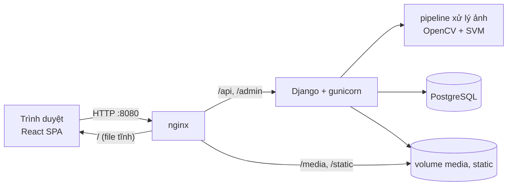
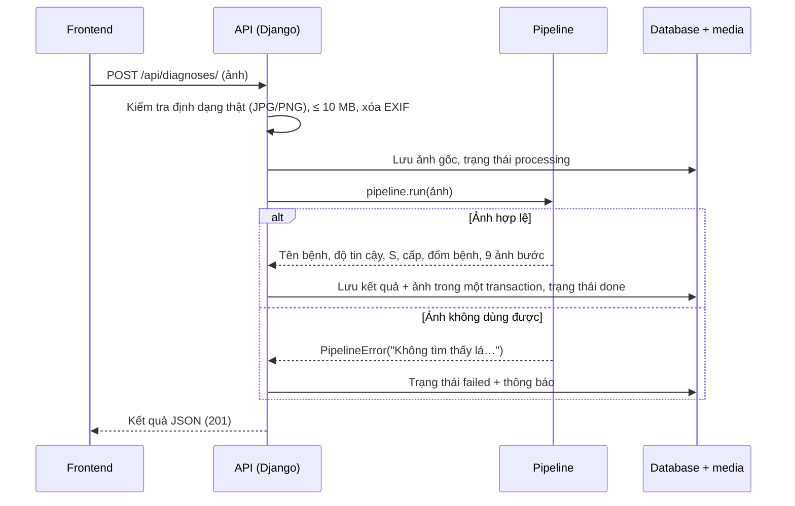

# Chương: Xây dựng ứng dụng Web

Chương này trình bày phần ứng dụng web đưa pipeline xử lý ảnh tới người dùng: kiến trúc tổng thể, API phía máy chủ, giao diện và cách đóng gói chạy bằng Docker. Các thuật toán xử lý ảnh và phân loại được trình bày ở các chương trước; ở đây pipeline được xem như một hàm `pipeline.run(ảnh) → kết quả`. Ảnh chụp màn hình giao diện chỉ có trong bản Word của chương (repo không lưu ảnh).

## 1. Kiến trúc tổng thể

Hệ thống gồm ba thành phần chạy riêng:

| Thành phần | Công nghệ | Vai trò |
|---|---|---|
| Giao diện (frontend) | React 19, Vite 8, Material UI 9, React Router 7 | Ứng dụng một trang (SPA) chạy trên trình duyệt: đăng ký, tải ảnh, xem kết quả, lịch sử, phản hồi |
| Máy chủ (backend) | Python 3.12, Django 6.1, Django REST Framework, SimpleJWT | API REST dạng JSON, xác thực, lưu kết quả; gọi pipeline xử lý ảnh (OpenCV, scikit-learn) |
| Cơ sở dữ liệu | PostgreSQL 17 | Tài khoản, lịch sử chẩn đoán, ảnh từng bước, danh mục bệnh, phản hồi, báo lỗi |

Ảnh (ảnh gốc, ảnh kết quả, ảnh từng bước) lưu thành file trong thư mục `media/`; database chỉ lưu đường dẫn.

*Hình 1. Kiến trúc khi chạy bằng Docker.*

Frontend và backend chỉ giao tiếp qua API JSON, nên mỗi bên phát triển và kiểm thử độc lập: backend có bộ test API riêng, frontend chỉ cần biết cấu trúc dữ liệu trả về (ghi trong `frontend/src/api/diagnoses.js`).

## 2. Backend và API

### 2.1. Dữ liệu

| Bảng | Nội dung |
|---|---|
| `users` | Tài khoản: email (đăng nhập), họ tên, mật khẩu đã băm, thời điểm và phiên bản điều khoản đã đồng ý, thời điểm xóa |
| `diseases` | 10 lớp bệnh lá cà chua của PlantVillage (mã lớp trùng nhãn của mô hình, tên tiếng Việt, cờ lá khỏe), nạp bằng migration |
| `diagnosis_histories` | Mỗi lần chẩn đoán: ảnh gốc, trạng thái (`pending`, `processing`, `done`, `failed`), bệnh và độ tin cậy, diện tích lá, diện tích vết bệnh, tỷ lệ S, cấp 0–4, danh sách đốm bệnh, ảnh kết quả, cờ đã lưu |
| `diagnosis_steps` | Ảnh trung gian của từng bước xử lý (9 bước) cho một lần chẩn đoán |
| `feedbacks` | Phản hồi "kết quả sai" gắn với một lần chẩn đoán, có trạng thái duyệt |
| `error_reports` | Báo lỗi ứng dụng của người dùng |

Ràng buộc nghiệp vụ được đặt ngay trong database (CHECK constraint), ví dụ: tỷ lệ S và độ tin cậy nằm trong [0, 1], cấp độ trong 0–4, Cấp 0 khi và chỉ khi không có vết bệnh, lần chẩn đoán `done` phải có đủ kết quả. Nhờ vậy dữ liệu sai không lọt vào database kể cả khi code có lỗi.

Khuyến nghị xử lý **không lưu** trong database vì chỉ phụ thuộc cấp độ và tên bệnh: khuyến nghị theo cấp (IPM) và khuyến nghị theo bệnh (tác nhân, biện pháp, nguồn tham khảo) là hằng số trong code, API trả kèm kết quả.

### 2.2. Các API

| Phương thức | Đường dẫn | Dữ liệu gửi | Kết quả |
|---|---|---|---|
| POST | `/api/auth/register/` | email, họ tên, mật khẩu, đồng ý điều khoản | Tạo tài khoản, trả luôn cặp token (đăng nhập ngay) |
| POST | `/api/auth/login/` | email, mật khẩu | Access token và refresh token |
| POST | `/api/auth/refresh/` | refresh token | Cặp token mới; refresh token cũ bị vô hiệu |
| POST | `/api/auth/logout/` | refresh token | Đưa refresh token vào danh sách thu hồi |
| POST | `/api/auth/delete-account/` | mật khẩu | Xóa tài khoản (ẩn danh hóa), thu hồi mọi refresh token |
| POST | `/api/diagnoses/` | ảnh (multipart) | Chạy pipeline, trả kết quả `done` hoặc `failed` |
| GET | `/api/diagnoses/` | `?page=`, `?is_bookmarked=true` | Lịch sử của chính người dùng, mới nhất trước, 20 mục/trang |
| GET | `/api/diagnoses/:id/` | | Chi tiết: kết quả, ảnh từng bước, hai loại khuyến nghị |
| PATCH | `/api/diagnoses/:id/` | `is_bookmarked` | Lưu hoặc bỏ lưu kết quả |
| POST | `/api/feedbacks/` | mã lần chẩn đoán, tiêu đề, mô tả | Phản hồi kết quả sai |
| POST | `/api/error-reports/` | tiêu đề, mô tả | Báo lỗi ứng dụng |

Trang `/admin/` (giao diện quản trị có sẵn của Django) dùng để xem người dùng, lịch sử chẩn đoán, duyệt phản hồi và xử lý báo lỗi.

### 2.3. Luồng chẩn đoán

*Hình 2. Luồng xử lý một ảnh tải lên.*

Một số quyết định thiết kế:
- **Chạy đồng bộ trong request**: một ảnh mất khoảng 1–3 giây (93% thời gian là bước tách lá bằng GrabCut), đủ nhanh để người dùng chờ, nên không cần hàng đợi tác vụ. Khi chạy bằng Docker, gunicorn đặt thời gian chờ 120 giây.
- **Kết quả luôn kết thúc ở `done` hoặc `failed`**: lỗi do ảnh (không tìm thấy lá, không đọc được ảnh) hiện nguyên văn cho người dùng; lỗi do code chỉ hiện thông báo chung và ghi log đầy đủ cho nhóm.
- **Lưu nguyên khối**: kết quả và các ảnh từng bước được lưu trong một transaction; nếu lưu giữa chừng thất bại, các file ảnh đã ghi bị xóa để không còn file mồ côi.
- **Kết quả lặp lại được**: seed ngẫu nhiên của GrabCut được cố định trong `pipeline.run`, nên cùng một ảnh luôn cho cùng một kết quả, giống lúc huấn luyện mô hình.

### 2.4. Xác thực và bảo vệ dữ liệu

- **JWT**: access token sống 30 phút, refresh token 7 ngày. Refresh token xoay vòng (dùng một lần) và bị đưa vào danh sách thu hồi khi đăng xuất. Frontend tự làm mới token khi gặp lỗi 401.
- Mọi API mặc định **yêu cầu đăng nhập**, trừ đăng ký và đăng nhập. Mỗi người dùng chỉ đọc được lịch sử của mình; mã lần chẩn đoán của người khác trả 404 như không tồn tại.
- **Mật khẩu** kiểm tra độ mạnh bằng bộ kiểm tra của Django (độ dài tối thiểu, không quá giống email hoặc họ tên, không thuộc danh sách mật khẩu phổ biến, không toàn số).
- **Ảnh tải lên**: kiểm tra định dạng thật bằng Pillow (không tin đuôi file), giới hạn 10 MB, xóa siêu dữ liệu EXIF (vị trí GPS, thiết bị) và đặt tên file ngẫu nhiên (UUID). Việc xóa EXIF lưu lại ảnh JPG (chất lượng 95) nên điểm ảnh đổi nhẹ; với ảnh có độ tin cậy sát ngưỡng, kết quả có thể khác khi chạy thẳng file gốc, vì vậy script chọn ảnh demo đọc ảnh theo đúng cách này.
- **Xóa tài khoản** không xóa cứng: email, họ tên bị xóa, mật khẩu không dùng được nữa, mọi refresh token bị thu hồi; lịch sử chẩn đoán vẫn giữ nhưng không còn gắn thông tin cá nhân. Email cũ đăng ký lại được thành tài khoản mới. Tài khoản quản trị không tự xóa được qua API, tránh trường hợp không còn ai vào được trang quản trị.

## 3. Giao diện

### 3.1. Các trang

| Trang | Đường dẫn | Nội dung |
|---|---|---|
| Đăng nhập, Đăng ký | `/login`, `/register` | Đăng ký phải đồng ý điều khoản; báo lỗi theo từng ô (email đã dùng, mật khẩu yếu) |
| Điều khoản | `/terms` | Điều khoản sử dụng, mở được khi chưa đăng nhập |
| Tải ảnh | `/` | Chọn ảnh JPG/PNG, xem trước, gửi chẩn đoán |
| Kết quả | `/results/:id` | Ảnh gốc và ảnh khoanh vùng vết bệnh; tên bệnh, độ tin cậy; tỷ lệ S, số đốm, thanh cấp độ 0–4; khuyến nghị theo cấp và theo bệnh; 9 ảnh bước xử lý; nút Lưu, Báo kết quả sai |
| Lịch sử | `/history` | Danh sách kết quả của mình, lọc "Tất cả" / "Đã lưu" (giữ trên URL), phân trang |
| Báo lỗi | `/error-report` | Gửi lỗi ứng dụng cho quản trị viên |
| Tài khoản | `/account` | Xóa tài khoản, xác nhận bằng mật khẩu |

Các trang cần đăng nhập được bọc trong một thành phần kiểm tra: chưa đăng nhập thì chuyển về `/login`, đăng nhập xong quay lại đúng trang cũ. Mã từng trang được tách thành file riêng và chỉ tải khi mở trang đó.

### 3.2. Trang kết quả

Trang kết quả là nơi thể hiện toàn bộ pipeline:
- **Ảnh từng bước**: chuẩn hóa kích thước → khử nhiễu → cân bằng sáng CLAHE → kênh S (HSV) → mặt nạ lá → vùng lá → mặt nạ mô lá khỏe → mặt nạ vết bệnh trước và sau phép mở/đóng hình thái học.
- **Cấp độ**: thanh 5 mức tô màu từ xanh (Cấp 0) tới đỏ (Cấp 4) kèm khoảng S tương ứng.
- **Khuyến nghị**: khuyến nghị theo cấp (IPM) và thẻ "Khuyến nghị cho <tên bệnh>" gồm tác nhân, biện pháp và nguồn tham khảo. Với bệnh virus, nhện đỏ và lá khỏe, khuyến nghị chung theo cấp không đúng (ví dụ bệnh virus không có thuốc chữa) nên chỉ hiện khuyến nghị theo bệnh, trừ khi độ tin cậy thấp hoặc lá khỏe mà vẫn có vết bệnh.
- **Cảnh báo kết quả đáng ngờ**: khung màu cam khi độ tin cậy dưới **0,55**, hoặc khi tên bệnh mâu thuẫn với cấp độ (lá khỏe nhưng Cấp ≥ 1; lớp bệnh nhưng Cấp 0, trừ hai bệnh virus vốn không có đốm). Ngưỡng 0,55 lấy theo đánh giá mô hình: trên tập test, ngưỡng này cảnh báo 12,2% số ảnh và bắt được 55,7% số dự đoán sai. Khung cảnh báo có nút mở hộp **Báo kết quả sai** với tiêu đề điền sẵn, để thu thập ảnh khó cho lần huấn luyện sau.

## 4. Đóng gói và triển khai bằng Docker

Cả hệ thống chạy bằng một lệnh `docker compose up` từ thư mục gốc repo:

| Dịch vụ | Image | Ghi chú |
|---|---|---|
| `db` | `postgres:17` | Dữ liệu trong volume `postgres-data`; có healthcheck, backend chỉ khởi động khi database sẵn sàng |
| `backend` | Python 3.12-slim, build từ `backend/Dockerfile` | Khi khởi động: `migrate`, `collectstatic`, tạo tài khoản quản trị nếu khai báo trong `.env`, rồi chạy gunicorn (2 worker). Image chứa sẵn file mô hình `classifier.joblib`, không chứa bộ dữ liệu ảnh |
| `frontend` | Build bằng Node 22, chạy bằng `nginx:1.27-alpine` | Phục vụ giao diện đã build; chuyển `/api`, `/admin` tới backend; phục vụ thẳng `/media`, `/static` từ volume |

- Cấu hình (mật khẩu database, khóa bí mật Django, cổng, tài khoản quản trị) đọc từ file `.env` theo mẫu `.env.example`; không có `.env` thì dùng giá trị mặc định chỉ để chạy thử.
- nginx giới hạn kích thước request 12 MB; ảnh lớn hơn bị chặn ngay và trả thông báo JSON "Ảnh vượt quá 10 MB." để giao diện hiện được tiếng Việt.
- Ảnh tải lên và database nằm trong volume, nên tắt rồi bật lại không mất dữ liệu.

## 5. Kiểm thử

- **Tự động**: khoảng 200 test chạy bằng `python manage.py test api image_processing experiments`, gồm test API (đăng ký, xác thực, chẩn đoán, quyền truy cập, lưu, phản hồi, xóa tài khoản, khuyến nghị đủ cho 10 lớp) và test các module xử lý ảnh. GitHub Actions chạy toàn bộ test, kiểm tra migration, lint và build frontend cho mỗi pull request; pull request chỉ được merge khi CI đạt và có người duyệt.
- **Thủ công**: kịch bản demo ([docs/demo.md](demo.md)) chạy trên bản Docker: đăng ký, tải ảnh, xem các bước xử lý, cấp độ, khuyến nghị, lưu, lịch sử, phản hồi, với bộ ảnh mẫu gồm mỗi lớp một ảnh, một ảnh độ tin cậy thấp và một ảnh không dùng được.
